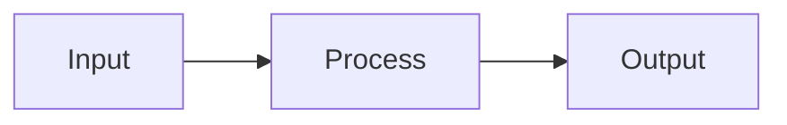

# Slidev Conventions for workshops.de

## Theme

All workshops use the `@workshops.de/slidev-theme` theme. This provides custom layouts.

## Available Layouts

| Layout | Usage |
|--------|-------|
| `cover` | First slide of a topic, with title and subtitle |
| `section` | Major section divider |
| `sub-section` | Sub-section divider |
| `why` | 4-MAT: Why this matters (connection) |
| `little-what` | 4-MAT: One-sentence summary of the concept |
| `what-if` | 4-MAT: Edge cases, alternatives, extensions |
| `task` | Exercise slide (announces hands-on time) |
| `two-cols-header` | Side-by-side comparison with header |
| `ask-me-anything` | Q&A slide |
| `end` | Final "Thank you" slide |
| `default` | Standard content slide (used when no layout specified) |

## Frontmatter for Lesson Entry Point

```yaml
---
background: https://cover.sli.dev
title: Lesson Title
info: |
  ## Lesson Title
  Brief description.
drawings:
  persist: false
transition: slide-left
mdc: true
seoMeta:
  ogImage: auto
base: /01-lesson-name/
out: ../../dist/01-lesson-name
theme: '@workshops.de/slidev-theme'
addons:
  - window-mockup
  - slidev-addon-tldraw
src: ./slides/first-topic/topic.md
---
```

Important fields:
- `base` must be `/<directory-name>/` (with leading and trailing slash)
- `out` must be `../../dist/<directory-name>`
- `src` points to the first topic's slides
- Additional topics are linked with separate `---\nsrc: ./slides/topic/topic.md\n---` blocks

## Slide Separation

Slides are separated by `---` on its own line. Only the very first slide in a file needs full frontmatter. Subsequent slides can have optional per-slide frontmatter:

```markdown
---
layout: cover
---

# First Slide

Content here

---
layout: section
---

# Second Slide

---

# Third Slide (default layout)

- Bullet point
- Another point
```

## Code Blocks

- Always annotate with the correct language: ```typescript, ```html, ```bash, etc.
- Use Shiki annotations for highlighting:
  - `// [!code highlight]` — highlight a line
  - `// [!code ++]` — show as added (green)
  - `// [!code --]` — show as removed (red)
  - `// [!code focus]` — focus this line, blur others
  - `// [!code warning]` — warning annotation
  - `// [!code error]` — error annotation
- For long code, use maxHeight for scrolling:
  ```ts {2|3|7}{maxHeight:'200px'}
  ```
- Line numbers are shown automatically for code blocks > 4 lines
- Never nest markdown code blocks inside HTML
- Maximum 2 code blocks per slide
- Prefer 1-10 lines of code per block

## WindowMockup Component

For displaying code in a browser/terminal window frame:

```html
<WindowMockup codeblock title="my-file.ts" padding="2rem">

```typescript
export function hello() {
  return 'world';
}
```

</WindowMockup>
```

## Magic Move (animated code transitions)

````markdown
````md magic-move
```typescript
// Step 1
const x = 1;
```
```typescript
// Step 2
const x = 1;
const y = 2;
```
````
````

## Two-Column Layout

```markdown
---
layout: two-cols-header
layoutClass: gap-x-2
---

# Title

::left::

Left column content

::right::

Right column content

::bottom::

Footer text
```

## Mermaid Diagrams

Use for processes and flows:

```markdown

```

## Slide Content Rules

1. Text must fit on one line per bullet point
2. No content overflow — if it doesn't fit, split into multiple slides
3. Avoid HTML when possible, use Markdown
4. Use HTML only for info boxes and special formatting with UnoCSS classes
5. For images alongside text, use two-column layout
6. Each topic should have 5-12 slides
7. Be clear and concise, avoid content duplication
